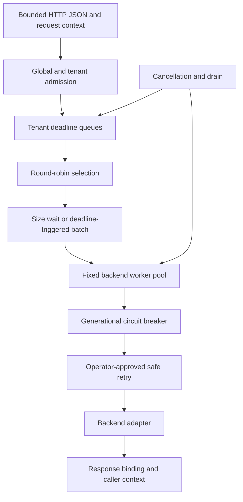

# ServeGate

[](https://github.com/pavan139/servegate/actions/workflows/ci.yml) 

A gateway that sits in front of a model server, written in Go with only the standard library. It provides deadline-aware microbatching, fair per-tenant admission, cancellation and circuit breaking. The backend is deterministic CPU work, so the results describe the queue and the batching, not model throughput.

Start the gateway, submit a request, then inspect what waited before the backend ran:

```sh
go run ./cmd/servegate serve --listen 127.0.0.1:8080
```

From another terminal:

```sh
curl -H 'X-Tenant-ID: demo' -H 'Content-Type: application/json' \
  --data-binary @loadtests/request.json http://127.0.0.1:8080/v1/infer
curl http://127.0.0.1:8080/metrics
```

`X-Timeout-Ms` can shorten the request budget. `X-Tenant-ID` is a caller-supplied label in this lab; an authenticated service would derive that identity before admission. The default backend performs deterministic SHA-256 CPU work. It gives the scheduler observable work without making a model-throughput claim.

## From admission to completion

One scheduler goroutine owns the tenant queues. Admission retains a global permit until the request has actually left the scheduler/backend, including after a client disconnects. Each tenant has an outstanding-request limit, tenants take turns round robin, and each tenant's queue uses earliest deadline first.



A batch flushes at its size limit, collection-window expiry, an imminent deadline, or drain. Cancellation of one member leaves other members running; cancellation of every member cancels the cooperative batch context. Late backend results are rejected. An arbitrary stuck Go function still needs to return before its worker can be reused.

Retries require both operator `RetrySafe=true` and the adapter's transient-error classification. The request cannot enable retries. Breaker permits carry generations so an old completion cannot close a newer open circuit. Closing the gateway rejects new admission, drains accepted work, and cancels cooperative workers when its close deadline expires.

Defaults are batch size eight, two workers, 128 outstanding requests globally, 32 per tenant, 16 active tenant labels, and a 2 ms collection window. Fairness is by request count; it does not allocate equal token or compute budgets. [Admission and shutdown](ops/admission-and-shutdown.md) specifies the remaining caps and state transitions.

## Measure the queue, not an imagined model

The saved [loopback run](benchmarks/evaluation.json) used the same 128 inputs, 16 clients and CPU work for both load variants. Batch size one made 128 backend calls; batch size eight made 16. In that run, elapsed time was 9.4288 ms versus 13.7142 ms. The batched run was slower despite fewer calls. Timings this small vary between runs, and a rerun of `evaluate` can reverse their order; the call counts do not change. Client errors and all attempted-request denominators remain in the JSON.

Controlled latch-backend runs also expose queued cancellation and a fifteen-request `A, B, C` service rotation. The [saturation notes](ops/saturation-runs.md) retain timings, latency quantiles, fairness scope and environment details.

```sh
GOFLAGS=-p=2 GOMAXPROCS=2 go test -race -count=1 ./...
go vet ./...
go run ./cmd/servegate demo --output artifacts/demo.json
go run ./cmd/servegate evaluate --output artifacts/evaluation.json
go build -trimpath -o build/servegate ./cmd/servegate
```

Use Go 1.23 or later. The recorded race run used Go 1.25.1 and executed 26 top-level tests with zero skips. The race detector needs a working C compiler. The module uses the standard library and downloads no backend model.

## Source and operating notes

- `gateway/` holds admission, queues, batching, the breaker, HTTP handling and their race tests.
- `experiment/` runs the loopback and controlled-backlog workloads.
- `cmd/servegate/` exposes `serve`, `demo` and `evaluate`.
- `loadtests/request.json` is the small HTTP request above; `benchmarks/` keeps recorded runs.
- [Request path](ops/request-path.md) and [race checks](ops/race-checks.md) connect the implementation to its invariants.

`python hack/check_gateway.py --require-lint --wheel --go /path/to/real/go` performs the full local verification. For this Go module, `--wheel` checks a built binary from a separate directory. [Distributing the gateway](ops/distributing-gateway.md) describes that binary and its source checks.
