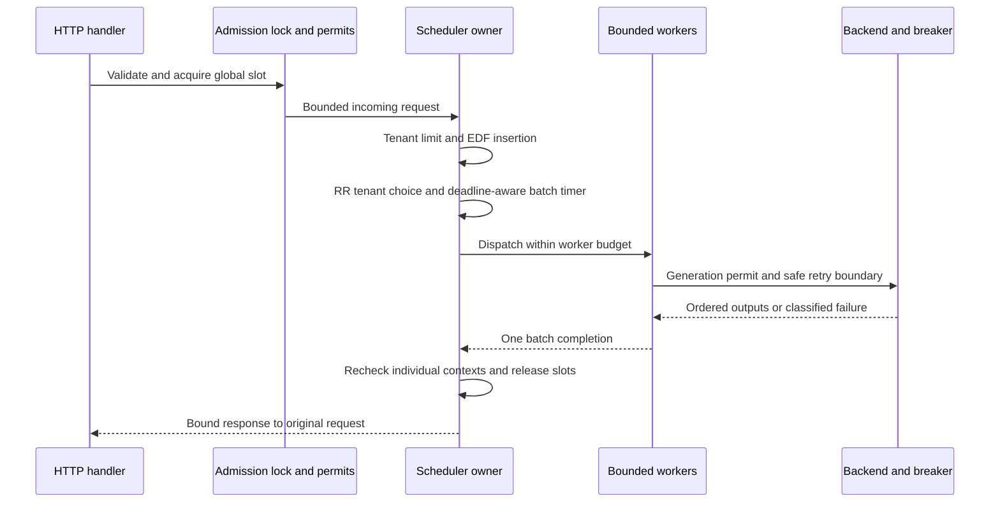

# The HTTP request path

`gateway/gateway.go` owns scheduling and lifecycle; `breaker.go` serializes breaker generations; `backend.go` defines the adapter and CPU fixture; `http.go` enforces the HTTP contract. `experiment` runs real loopback load/cancellation and controlled backlog fairness. The CLI can run experiments or serve an actual local HTTP endpoint.

No model or provider is hidden behind the fixture. No client field grants retry safety, identity authentication, or additional execution permissions. See [admission-and-shutdown.md](admission-and-shutdown.md) for timing math, ownership, complexity, and failure outcomes, and [saturation-runs.md](saturation-runs.md) for actual observations.
